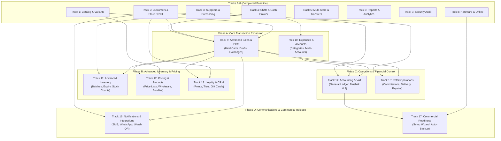

# Next Phase Gap Analysis & Architecture Roadmap: Tracks 9–17

**Date:** 2026-11-04  
**Project:** Retail POS System (Bangladesh Retail Market)  
**Author:** Senior Software Architect & Full-Stack Engineering Team  
**Status:** Completed & Awaiting Customer Approval Before Track 9 Implementation  

---

## 1. Executive Overview

The Retail POS System has completed **Tracks 1 through 8**, establishing an offline-first modular monolith backed by Python FastAPI, SQLAlchemy 2.0 Async, PostgreSQL 16, and Flutter 3 Desktop for Windows x64. The platform currently supports core catalog management, customer CRM with credit limits, supplier purchasing, immutable inventory ledger movements, cashier shift cash reconciliation with daily Z-reports, multi-store stock transfers, executive reports with CSV exports, ESC/POS thermal printing, HID barcode scanners, offline cryptographic licensing, and gzip database disaster backups verified across 96 automated tests.

This document presents a comprehensive **Gap Analysis** comparing the verified existing repository implementation against the requirements for **Tracks 9 through 17**:
- **Track 9:** Advanced Sales and POS
- **Track 10:** Expense and Financial Management
- **Track 11:** Advanced Inventory
- **Track 12:** Advanced Product and Pricing
- **Track 13:** Customer Loyalty and CRM
- **Track 14:** Accounting and Tax/VAT (NBR Bangladesh Compliance)
- **Track 15:** Advanced Retail Operations
- **Track 16:** Notifications and Integrations
- **Track 17:** Commercial Readiness

---

## 2. Baseline Verification: Tracks 1–8 (Ground Truth in Codebase)

The claims regarding Tracks 1–8 have been verified directly in the source code on disk:

```
Verified Repository Baseline
============================
Backend Source Files   : 79 Python modules across backend/app/
Database Tables        : 22 tables active in public schema up to migration 254c6db01cfc
Backend Test Suite     : 58 passed, 1 skipped in 63.03s (backend/tests/)
Flutter Test Suite     : 38 passed across 9 suites in pos_system_application/test/
Static Analysis Status : ruff: 0 errors | mypy: 0 errors | flutter analyze: 0 errors
```

| Area | Implemented Features Verified in Code | Verified File References |
|---|---|---|
| **Catalog & Products** | Categories, Brands, Products, Variants (Standard, Apparel, Serialized IMEI, Non-Inventory services), Barcode/SKU indexing. | `app/modules/catalog/models.py`<br>`app/api/v1/catalog.py` |
| **Customers & Due Credit** | CRM directory, credit limit enforcement, split/due tenders, FIFO debt collection against unpaid sales. | `app/modules/customers/service.py`<br>`app/api/v1/customers.py` |
| **Purchasing & Inventory** | Vendor management, PO receiving updating cost prices, manual stock adjustments (`UP`/`DOWN`), append-only ledger. | `app/modules/purchasing/service.py`<br>`app/modules/inventory/service.py` |
| **Cash Drawer & Shifts** | Register shifts (`OPEN`/`CLOSED`), float setup, cash in/out drops, denomination tally variance, thermal Z-Report. | `app/modules/shifts/service.py`<br>`app/api/v1/shifts.py` |
| **Multi-Store & Sync** | Multi-branch registry, inter-branch stock transfers (`DRAFT` $\to$ `IN_TRANSIT` $\to$ `RECEIVED`), cross-branch stock query, delta sync. | `app/modules/inventory/transfer_service.py`<br>`app/api/v1/sync.py` |
| **Analytics & Reports** | Executive KPIs, hourly/daily sales time-series (FlChart), stock valuation, tender distribution, customer debt aging, CSV stream. | `app/modules/reports/service.py`<br>`app/api/v1/reports.py` |
| **Hardware & Packaging** | ESC/POS binary generator (80mm/58mm), cash drawer pulse (`ESC p 0`), HID scanner wedge listener, offline license, `.json.gz` backup. | `lib/core/hardware/`<br>`launcher/run_pos_desktop.bat` |

---

## 3. Track-by-Track Gap Analysis (Tracks 9–17)

---

### Track 9: Advanced Sales and POS (✅ Completed & Verified)

#### 1. Objective
Transform standard checkout into an enterprise POS sales engine supporting held carts, draft quotations, advance sales orders, line-level and cart-level discounts, product exchanges, delivery charges, and manager approval overrides.

#### 2. Implementation Status & Deliverables Delivered
- **Migration `c38f19e4a2b1_add_held_carts_and_quotations.py`**:
  - `held_carts`: Parked baskets with JSONB items, discounts, delivery charge, taxes, and customer tags.
  - `quotations` & `quotation_items`: Pro-forma quotation engine with auto-generated sequential numbers (`QT-YYYYMMDD-BRANCH-XXXX`), validity duration, and conversion tracking.
  - `sales` alterations: Added `delivery_charge`, `sale_type` (`RETAIL`, `EXCHANGE`, `DELIVERY`), `manager_approved_by`, `exchange_return_id`.
  - `sale_items` alterations: Added `discount_type` (`PERCENTAGE`, `FIXED`), `discount_reason`.
- **Backend APIs (`app/api/v1/sales.py`)**:
  - `POST /api/v1/sales/held-carts`, `GET /held-carts`, `GET /held-carts/{id}`, `DELETE /held-carts/{id}`.
  - `POST /api/v1/sales/quotations`, `GET /quotations`, `GET /quotations/{id}`, `POST /quotations/{id}/convert`.
  - `POST /api/v1/sales/exchange`: Atomic transaction handling return restocking, new replacement product deduction, and net difference payment tender.
  - `POST /api/v1/sales/manager-override`: Validates supervisor PIN/password and emits authorized action tokens.
- **Flutter Client UI & Controllers**:
  - `HeldCartsDialog`: View parked baskets, restore with 1-click, and discard.
  - `LineDiscountDialog`: Toggle between `%` and `Fixed ৳`, quick chips (5%, 10%, 15%, 20%, 25%), reason chips, automatic supervisor check if $> 20\%$.
  - `ManagerOverrideDialog`: PIN keypad modal with on-screen touch pad and error handling.
  - `DeliveryChargeDialog`: Presets (Free, Inside City, Outside City, Express) + custom input.
  - `SaveQuotationDialog`: Pro-forma quote generation with 7/15/30/60 days validity.
  - `QuotationsView`: Tab under Sales History for quotation management, details drawer, POS cart loader, direct settlement.
  - `ProductExchangeDialog`: Dual-pane exchange view (returns + catalog replacements + net difference tender settlement).
  - `PosRegisterScreen`: Integrated compact header with Parked Carts badge button, more order options (Hold, Quote, Clear), restored held cart indicator banner, line item discount buttons, delivery fee row.
- **Automated Verification**:
  - Backend tests: `backend/tests/test_advanced_sales.py` (5 passed, 63 full suite).
  - Flutter tests: `pos_system_application/test/advanced_sales_widget_test.dart` (6 passed, 44 full suite).
  - Static analysis: `ruff` 0 errors, `mypy` 0 errors in 79 files, `flutter analyze` 0 issues.

---

### Track 10: Expense and Financial Management [COMPLETED & VERIFIED]

#### 1. Objective
Establish comprehensive store expense tracking, recurring bills, multi-account cash/bank liquidity management, accounts payable aging, and daily financial reconciliation.

#### 2. Implemented & Verified Capabilities (Track 10 Completed)
- **Database Schema (Alembic Migration `d49e20f5b3c2`):**
  - Table `expense_categories` (id, business_id, name, code, description, monthly_budget, is_active, created_at).
  - Table `financial_accounts` (id, business_id, branch_id, account_name, account_type, account_number, bank_name, opening_balance, current_balance, is_active, created_at).
  - Table `account_transfers` (id, business_id, from_account_id, to_account_id, amount, reference_no, note, transfer_date, created_by, created_at).
  - Table `recurring_expenses` (id, business_id, branch_id, category_id, payment_account_id, title, amount, frequency, next_due_date, last_generated_at, auto_post, is_active, created_at).
  - Enhanced `expenses` table with `voucher_no`, `category_id`, `payment_account_id`, `payment_method`, `payee`, `receipt_reference`, `tax_deductible`, `approval_status`, `approved_by`, `approved_at`.
- **Domain Services & Backend Logic (`backend/app/modules/expenses/`):**
  - Deadlock-free inter-account transfers with lexicographically ordered `with_for_update()` row locks (`get_accounts_for_transfer`).
  - Strict non-negative liquidity constraints on accounts.
  - Automatic manager authorization threshold (> ৳ 5,000 holds voucher as `PENDING_APPROVAL`, balances decremented only upon sign-off).
  - Recurring schedule runner with automatic date advancement (`advance_due_date` across DAILY, WEEKLY, MONTHLY, QUARTERLY, ANNUAL).
  - 30-day net cash flow statement (sales cash inflows vs expense/supplier outflows).
  - Accounts Payable (AP) aging engine (0–30, 31–60, 61–90, 90+ days).
- **REST Endpoints (`backend/app/api/v1/`):**
  - `/api/v1/expenses`: `GET`, `POST`, `POST /{id}/approve`.
  - `/api/v1/expenses/categories`: `GET`, `POST`, `PUT /{id}`.
  - `/api/v1/expenses/recurring`: `GET`, `POST`, `PUT /{id}`, `POST /process`.
  - `/api/v1/financial-accounts`: `GET`, `POST`, `PUT /{id}`.
  - `/api/v1/financial-accounts/transfers`: `POST`, `GET`.
  - `/api/v1/financial-accounts/reports/cash-flow` & `/reports/ap-aging`.
- **Flutter UI & State Management (`pos_system_application/`):**
  - Domain models & serialization (`ExpenseModel`, `ExpenseCategoryModel`, `FinancialAccountModel`, `AccountTransferModel`, `RecurringExpenseModel`, `CashFlowReportModel`, `APAgeingReportModel`).
  - Riverpod controllers (`expenses_controller.dart`, `financial_accounts_controller.dart`).
  - `ExpensesScreen` with 3 tabs: Vouchers (with supervisor approve/reject actions), Category Budgets (visual progress bars), Recurring Schedules.
  - `ExpenseFormDialog` with dynamic manager approval warning when amount > ৳ 5,000.
  - `FinancialAccountsScreen` displaying Total Liquid Capital banner, Account cards, AP aging breakdown, 30-day Cash Flow summary, and audit ledger.
  - `AccountTransferDialog` with real-time balance checks.
  - Integrated into `ShellScreen` NavigationRail.
- **Verification:**
  - `ruff check backend`: 100% clean (0 errors).
  - `mypy backend`: 100% clean (0 errors across 8 source files).
  - `flutter analyze`: 100% clean (0 errors, 0 warnings).
  - `flutter test`: **52 / 52 tests passed (100%)** including 8 dedicated tests in `expenses_widget_test.dart`.

---

### Track 11: Advanced Inventory

> **STATUS: COMPLETED & VERIFIED (100% Passed)**

#### 1. Implementation Summary
- **Database & Migrations:**
  - Alembic migration `e50f31a1b4d3_add_advanced_inventory.py`:
    - Created `inventory_batches` table with unique constraint on `(business_id, branch_id, product_variant_id, batch_number)`.
    - Created `damaged_stock_records` table with voucher number tracking (`DAM-YYYYMMDD-XXXX`).
    - Created `stock_reservations` table with status and `reserved_until` expiry timestamp.
    - Altered `stock_movements`: added `batch_id` foreign key and index.
    - Altered `product_variants`: added `has_batch_tracking`, `min_stock_level`, `reorder_quantity`.
    - Altered `branches`: added `branch_type` (`RETAIL_STORE`, `CENTRAL_WAREHOUSE`).
- **Backend Architecture & Domain Logic:**
  - `InventoryBatch` FEFO (First-Expired, First-Out) picking allocation during sales and deductions.
  - Expiry alert calculation engine with urgency tiers (`CRITICAL_EXPIRED`, `HIGH_7_DAYS`, `MEDIUM_30_DAYS`, `LOW_60_DAYS`).
  - Damaged stock write-off vouchers with loss calculation in BDT and automatic audit ledger movement generation.
  - Stock reservation engine guaranteeing zero overselling:
    $$\text{Available Stock} = \text{quantity\_on\_hand} - \sum \text{quantity of ACTIVE reservations}$$
  - Physical stock count audit sessions with barcode tallying and automatic reconciliation posting (`ADJUSTMENT_UP` / `ADJUSTMENT_DOWN`).
  - Replenishment reorder intelligence based on `min_stock_level`, `reorder_quantity`, and active reservations.
  - Multi-tier inventory valuation report aggregating FIFO (batch lot-based), Weighted Average Cost (WAC), and Retail valuation across product categories.
- **Flutter Desktop Application:**
  - Domain models: `InventoryBatchModel`, `ExpiryAlertModel`, `DamagedStockModel`, `StockReservationModel`, `AvailableStockModel`, `StockCountModel`, `ReorderSuggestionModel`, `InventoryValuationReportModel`.
  - Service: `AdvancedInventoryApiService` communicating with `/api/v1/inventory/*`.
  - Controllers: `BatchesListNotifier`, `DamagedStockNotifier`, `StockReservationsNotifier`, `StockCountsNotifier`, `reorderSuggestionsProvider`, `inventoryValuationProvider`.
  - Views:
    - `AdvancedInventoryScreen` with 5 tabs (Batches & Expiry, Physical Audits, Damaged Stock, Reservations, Reorder & Valuation).
    - `BatchInwardDialog`, `DamagedStockDialog`, `StockReservationDialog`, `StockCountSessionDialog`.
    - Integrated as 3rd tab in `CatalogScreen`.
- **Verification:**
  - `ruff check backend`: 100% clean (0 errors).
  - `mypy backend`: 100% clean (0 errors across 8 source files).
  - `flutter analyze`: 100% clean (0 errors, 0 warnings).
  - `flutter test`: **59 / 59 tests passed (100%)** including 7 dedicated tests in `advanced_inventory_widget_test.dart`.

---

### Track 12: Advanced Product and Pricing

#### 1. Objective
Support multi-tier pricing, wholesale price breaks, branch-specific price overrides, product combos/bundles, promotional coupons, and bulk Excel catalog importing.

#### 2. Existing Verified Assets & Reusable Components
- `ProductVariant` stores standard `cost_price` and `selling_price`.
- `CatalogService` and `catalog_router` support product and variant CRUD.
- Flutter `CatalogScreen` has search, category filtering, and product form dialogs.

#### 3. Missing / Gap Features
- **Price Lists & Wholesale:** Only one fixed selling price per variant exists. No customer-tier pricing (Wholesale vs Retail) or volume quantity breaks.
- **Branch-Specific Overrides:** All branches currently inherit the exact same selling price from `ProductVariant.selling_price`.
- **Bundles & Combo Packs:** No composite products where selling 1 Combo SKU automatically decrements multiple sub-component variant balances.
- **Coupons & Promo Codes:** Cart discount is manual entry only; no discount code engine validating redemption count, date ranges, or minimum spend.
- **Scheduled Price Changes:** No mechanism to schedule price adjustments taking effect at midnight or a specified date.
- **Bulk Excel/CSV Import:** No bulk spreadsheet upload parser to create or update thousands of products in one operation.

#### 4. Database Changes Required
- **New Table `price_lists` & `price_list_items`:**
  - `price_lists`: `id`, `business_id`, `name` (String 100), `currency` (String 10), `is_default` (Boolean), `is_active` (Boolean).
  - `price_list_items`: `id`, `price_list_id`, `product_variant_id`, `min_quantity` (Numeric 12,4 default 1.0), `price` (Numeric 19,4).
- **New Table `branch_price_overrides`:**
  - `id`, `business_id`, `branch_id`, `product_variant_id`, `selling_price` (Numeric 19,4).
  - Unique constraint: `("branch_id", "product_variant_id")`.
- **New Table `product_bundles` & `product_bundle_items`:**
  - `parent_product_id` (UUID), `component_variant_id` (UUID), `quantity` (Numeric 12,4).
- **New Table `promotions` & `coupons`:**
  - `id`, `business_id`, `code` (String 50, unique), `discount_type` (`PERCENTAGE`, `FIXED`), `discount_value` (Numeric 19,4), `min_spend` (Numeric 19,4), `usage_limit` (Integer), `times_used` (Integer), `valid_from` (DateTime), `valid_until` (DateTime), `is_active` (Boolean).

#### 5. API Endpoints Required
- `GET/POST/PUT /api/v1/pricing/price-lists` & `POST /api/v1/pricing/price-lists/{id}/items`
- `GET/POST /api/v1/pricing/branch-overrides`
- `GET/POST /api/v1/pricing/bundles`
- `GET/POST /api/v1/pricing/coupons` & `POST /api/v1/pricing/coupons/validate`
- `POST /api/v1/catalog/bulk-import` (Multipart Excel `.xlsx` / `.csv` upload with mapping)

#### 6. Flutter Screens & UI Required
- `PriceListsScreen`: Manager UI to configure Wholesale and VIP price schedules and volume breaks.
- `BundlesManagementDialog`: Form to assemble component variants into a sellable combo pack.
- `CouponsScreen`: Promotional code management table with active dates and usage limits.
- `BulkImportWizard`: Step-by-step dialog to upload Excel/CSV, map columns, preview records, and report validation errors before import.
- POS Cart integration: Coupon code input field in `PosRegisterScreen` with instant discount calculation.

#### 7. Complexity & Risk
- **Estimated Complexity:** High (3 weeks)
- **Technical Risk:** Medium. Bundles require atomic inventory validation and deduction across multiple component variants during checkout.

---

### Track 13: Customer Loyalty and CRM

#### 1. Objective
Drive customer retention and lifetime value through loyalty points, tiered membership levels, store credit accounts, gift cards, and RFM segmentation.

#### 2. Existing Verified Assets & Reusable Components
- `Customer` model with `phone`, `credit_limit`, `due_balance`, and spend tracking.
- `CustomersService` with unique phone indexing and debt collection.
- `CustomerSelectionDialog` in Flutter POS checkout.

#### 3. Missing / Gap Features
- **Loyalty Points Engine:** No points calculation on sales (e.g. 1 point per ৳ 100 spent) or redemption rules during checkout.
- **Membership Tiers:** No Silver, Gold, Platinum tiers with automatic upgrade rules based on annual spending.
- **Gift Cards:** No gift card creation, barcode activation, balance checking, or `GIFT_CARD` tender method.
- **Store Credit (Prepaid Balance):** System currently only tracks negative debt (`due_total`), not positive prepaid store credits.
- **RFM Customer Segmentation:** No analytics classifying customers into Champions, Loyal, At-Risk, or Dormant segments.

#### 4. Database Changes Required
- **New Table `loyalty_programs` & `loyalty_transactions`:**
  - `loyalty_programs`: `id`, `business_id`, `points_per_currency` (Numeric 12,4), `redemption_rate` (Numeric 12,4), `is_active` (Boolean).
  - `loyalty_transactions`: `id`, `business_id`, `customer_id`, `sale_id` (nullable), `points_delta` (Integer), `transaction_type` (`EARN`, `REDEEM`, `EXPIRE`, `ADJUST`), `created_at`.
- **New Table `customer_groups` / `membership_tiers`:**
  - `id`, `business_id`, `tier_name` (String 50), `min_spend_threshold` (Numeric 19,4), `points_multiplier` (Numeric 5,2), `discount_percentage` (Numeric 5,2).
- **New Table `gift_cards`:**
  - `id`, `business_id`, `card_number` (String 50, unique), `pin_hash` (String 255), `initial_balance` (Numeric 19,4), `current_balance` (Numeric 19,4), `expires_at` (DateTime), `status` (`ACTIVE`, `REDEEMED`, `CANCELLED`).
- **Alter Table `customers`:**
  - Add `loyalty_points` (Integer default 0).
  - Add `store_credit_balance` (Numeric 19,4 default 0.0000).
  - Add `tier_id` (UUID foreign key `membership_tiers.id` nullable).

#### 5. API Endpoints Required
- `GET/POST /api/v1/loyalty/program` & `GET /api/v1/customers/{id}/loyalty-history`
- `POST /api/v1/loyalty/redeem` (Redeem points for cart discount)
- `GET/POST /api/v1/gift-cards` & `POST /api/v1/gift-cards/verify-balance`
- `GET/POST /api/v1/customers/tiers`
- `GET /api/v1/customers/analytics/rfm-segments`

#### 6. Flutter Screens & UI Required
- `LoyaltySettingsScreen`: Admin configuration for points earning/redemption ratios and tier perks.
- `GiftCardManagementScreen`: Table to issue, search, check balances, and deactivate gift cards.
- POS Checkout Integration: Points balance display on customer selection card with "Redeem Points" slider and "Gift Card" payment tender modal.
- `CustomerSegmentationTab`: Interactive RFM chart inside Customers screen.

#### 7. Complexity & Risk
- **Estimated Complexity:** Medium-High (2.5 weeks)
- **Technical Risk:** Low. Independent transactional tables; requires clean integration into checkout tender allocation.

---

### Track 14: Accounting and Tax/VAT (NBR Bangladesh Compliance)

#### 1. Objective
Implement automated double-entry accounting, General Ledger, Chart of Accounts, Trial Balance, P&L, Balance Sheet, and Bangladesh National Board of Revenue (NBR) Mushak 6.3 compliant VAT reporting.

#### 2. Existing Verified Assets & Reusable Components
- Exact Decimal `NUMERIC(19, 4)` and `ROUND_HALF_UP` arithmetic already standard throughout the backend.
- Sales, Returns, Purchases, and Due repayments record exact monetary flows.
- 5% VAT rate calculation implemented in `CheckoutService`.

#### 3. Missing / Gap Features
- **Chart of Accounts (COA):** No standardized ledger accounts (Assets, Liabilities, Equity, Revenue, COGS, Expenses).
- **Double-Entry Journal Entries:** Sales, inventory deductions, and purchases currently write to domain tables only; no balanced debit/credit journal transactions are recorded.
- **Financial Statements:** No engine to generate real Balance Sheets, Trial Balances, or Income Statements (P&L) from journal lines.
- **NBR Bangladesh Tax Rules (Mushak 6.3):** No formal Mushak-6.3 tax invoice generation, tax withholding management, or standard NBR VAT return schedules (Mushak 9.1 summary).

#### 4. Database Changes Required
- **New Table `chart_of_accounts`:**
  - `id` (UUID), `business_id` (UUID), `account_code` (String 50, unique per tenant), `account_name` (String 255), `account_category` (`ASSET`, `LIABILITY`, `EQUITY`, `REVENUE`, `COGS`, `EXPENSE`), `parent_account_id` (UUID nullable), `is_system` (Boolean), `is_active` (Boolean).
- **New Table `journal_entries` & `journal_lines`:**
  - `journal_entries`: `id`, `business_id`, `entry_no` (String 50), `entry_date` (DateTime), `reference_type` (`SALE`, `PURCHASE`, `PAYMENT`, `EXPENSE`, `MANUAL`), `reference_id` (UUID nullable), `memo` (Text), `is_posted` (Boolean).
  - `journal_lines`: `id`, `journal_entry_id` (UUID), `account_id` (UUID), `debit` (Numeric 19,4 default 0.0000), `credit` (Numeric 19,4 default 0.0000), `description` (Text).
  - Check constraint: `SUM(debit) == SUM(credit)` per entry.
- **New Table `tax_configurations`:**
  - `id`, `business_id`, `tax_name` (String 100), `rate_percentage` (Numeric 5,2), `mushak_category` (String 50), `is_default` (Boolean).

#### 5. API Endpoints Required
- `GET/POST/PUT /api/v1/accounting/accounts` (Chart of Accounts CRUD)
- `GET/POST /api/v1/accounting/journal-entries` (Manual and automated journal entries)
- `GET /api/v1/accounting/general-ledger`
- `GET /api/v1/accounting/trial-balance`
- `GET /api/v1/accounting/profit-loss`
- `GET /api/v1/accounting/balance-sheet`
- `GET /api/v1/accounting/vat/mushak-6-3/{sale_id}` & `GET /api/v1/accounting/vat/mushak-summary`

#### 6. Flutter Screens & UI Required
- `ChartOfAccountsScreen`: Tree-view hierarchy of financial accounts with balances.
- `JournalEntriesScreen`: Searchable ledger of posted entries with balanced debit/credit lines.
- `FinancialStatementsScreen`: Tabbed view for Trial Balance, P&L Statement, and Balance Sheet with date range selectors and PDF/CSV export.
- `VatComplianceScreen`: Bangladesh NBR VAT reports with printable Mushak 6.3 tax invoice view.

#### 7. Complexity & Risk
- **Estimated Complexity:** Very High (3.5 weeks)
- **Technical Risk:** High. Every business event (sale, return, purchase, expense, shift variance) must generate balanced debits and credits without degrading checkout response times.

---

### Track 15: Advanced Retail Operations

#### 1. Objective
Enhance daily shop floor operations with employee commission tracking, delivery fulfillment tracking, repair/service ticket management, and supplier quotation (RFQ) comparison.

#### 2. Existing Verified Assets & Reusable Components
- `User` and `Membership` models track cashiers and store permissions.
- `Sale.cashier_id` tracks the processing user.
- `Supplier` and `Purchase` models provide the foundation for vendor procurement.

#### 3. Missing / Gap Features
- **Sales Staff & Commissions:** System cannot assign a dedicated sales representative to a line item (distinct from the cashier operating the register) or compute commission payouts.
- **Delivery Fulfillment:** No delivery status tracking (`PENDING`, `DISPATCHED`, `DELIVERED`, `RETURNED`) or Cash-on-Delivery (COD) cash reconciliation.
- **Repairs & Service Management:** Retail electronics shops cannot issue repair job cards, track device diagnostic notes, record spare parts consumed, or bill repair labor.
- **Supplier RFQ & Quotation Comparison:** No workflow to request price quotes from multiple vendors before issuing a Purchase Order.
- **Purchase Order Approval:** No manager approval threshold for large supplier purchase orders.

#### 4. Database Changes Required
- **New Table `sales_commissions` & `commission_rules`:**
  - `commission_rules`: `id`, `business_id`, `role_or_user_id` (UUID), `rate_type` (`PERCENTAGE_SALES`, `PERCENTAGE_MARGIN`, `FIXED_PER_UNIT`), `rate_value` (Numeric 19,4).
  - `sales_commissions`: `id`, `business_id`, `sale_item_id` (UUID), `salesperson_id` (UUID), `commission_amount` (Numeric 19,4), `payout_status` (`PENDING`, `PAID`).
- **New Table `delivery_orders`:**
  - `id`, `business_id`, `sale_id` (UUID), `delivery_partner` (String 100), `tracking_no` (String 100), `recipient_name`, `recipient_phone`, `delivery_address`, `cod_amount` (Numeric 19,4), `status` (`PREPARING`, `DISPATCHED`, `DELIVERED`, `FAILED_RETURNED`), `dispatched_at`, `delivered_at`.
- **New Table `repair_orders` & `repair_parts`:**
  - `id`, `business_id`, `ticket_no` (String 50), `customer_id` (UUID), `device_model` (String 100), `serial_imei` (String 100), `problem_description` (Text), `technician_id` (UUID), `status` (`RECEIVED`, `DIAGNOSING`, `WAITING_PARTS`, `COMPLETED`, `RETURNED`), `labor_cost` (Numeric 19,4), `total_cost` (Numeric 19,4).
- **New Table `supplier_rfqs` & `supplier_quotations`:**
  - Multi-vendor quotation comparison matrix before PO creation.

#### 5. API Endpoints Required
- `GET/POST /api/v1/operations/commissions` & `POST /api/v1/operations/commissions/payout`
- `GET/POST/PUT /api/v1/operations/deliveries` & `POST /api/v1/operations/deliveries/{id}/cod-settle`
- `GET/POST/PUT /api/v1/operations/repairs` & `POST /api/v1/operations/repairs/{id}/convert-to-sale`
- `GET/POST /api/v1/operations/rfqs`

#### 6. Flutter Screens & UI Required
- `RepairServiceScreen`: Service workshop Kanban board (Received $\to$ Diagnosing $\to$ Done) with printable repair intake slips.
- `DeliveryManagementScreen`: Orders ready for dispatch, driver assignment, and COD collection modal.
- `CommissionReportScreen`: Sales rep commission summary and payout authorization.
- `SalespersonSelector`: Line-level dropdown on POS checkout cart to credit individual sales staff.

#### 7. Complexity & Risk
- **Estimated Complexity:** High (3 weeks)
- **Technical Risk:** Medium. Delivery COD settlement must link back to cash drawer and shift reconciliation.

---

### Track 16: Notifications and Integrations

#### 1. Objective
Connect the retail shop with customer communication channels (SMS, Email, WhatsApp Business), payment gateway adapters (bKash, Nagad, Card terminals), e-commerce webhooks, and local desktop notifications.

#### 2. Existing Verified Assets & Reusable Components
- `AuditLog` records data mutation events.
- `SyncOutbox` model exists in `app/modules/platform/models.py` (`event_id`, `aggregate_type`, `event_type`, `payload_json`, `synced_at`) providing an outbox pattern for asynchronous event publishing.
- `PaymentTender` records payment methods (`CASH`, `CARD`, `BKASH`, `NAGAD`, `DUE`).

#### 3. Missing / Gap Features
- **SMS Gateway Drivers:** No integration with Bangladesh SMS providers (SSL Wireless, Greenweb, MimSMS) for checkout receipts, debt reminders, and OTPs.
- **Email Service (SMTP):** No email delivery engine for daily Z-Reports or PDF invoices.
- **WhatsApp Cloud API:** No automated template-based WhatsApp dispatch for electronic cash memos.
- **Payment Terminal / Gateway Adapters:** bKash and Nagad payments are currently recorded manually by entering the transaction ID; no automated QR code generation or API webhook verification exists.
- **External Webhooks:** No webhook subscription dispatcher when products or inventory change (needed for Shopify/WooCommerce syncing).
- **Desktop Toast Notifications:** No native Windows notification prompts for low stock or shift closing reminders.

#### 4. Database Changes Required
- **New Table `notification_templates` & `notification_logs`:**
  - `notification_templates`: `id`, `business_id`, `channel` (`SMS`, `EMAIL`, `WHATSAPP`), `event_trigger` (`SALE_COMPLETED`, `DUE_REMINDER`, `LOW_STOCK_ALERT`, `Z_REPORT`), `template_body` (Text), `is_active` (Boolean).
  - `notification_logs`: `id`, `business_id`, `recipient` (String 255), `channel`, `status` (`QUEUED`, `SENT`, `FAILED`), `error_message`, `sent_at`.
- **New Table `integration_configs`:**
  - `id`, `business_id`, `provider_type` (`SMS_GATEWAY`, `PAYMENT_GATEWAY`, `SMTP`, `WEBHOOK`), `credentials_json` (Encrypted JSONB), `is_active` (Boolean).
- **New Table `webhook_subscriptions`:**
  - `id`, `business_id`, `target_url` (String 500), `secret_key` (String 255), `subscribed_events` (JSONB), `is_active` (Boolean).

#### 5. API Endpoints Required
- `GET/POST/PUT /api/v1/integrations/settings`
- `POST /api/v1/integrations/sms/send` & `POST /api/v1/integrations/email/send-zreport`
- `POST /api/v1/integrations/payments/bkash/create-payment` & `POST /api/v1/integrations/payments/bkash/callback`
- `GET/POST /api/v1/integrations/webhooks`

#### 6. Flutter Screens & UI Required
- `IntegrationsSettingsScreen`: Configuration panel for SMS API keys, WhatsApp credentials, SMTP server, and bKash Merchant account.
- `MessageTemplatesScreen`: Visual template editor with merge tags (`{{customer_name}}`, `{{receipt_no}}`, `{{total}}`, `{{due_balance}}`).
- Customer profile action: One-click "Send Due Reminder SMS" button.
- POS Checkout integration: Dynamic QR code display for bKash/Nagad payments.

#### 7. Complexity & Risk
- **Estimated Complexity:** High (2.5 weeks)
- **Technical Risk:** Medium. Outgoing communications must run asynchronously via background workers or the `SyncOutbox` queue to ensure network latency never slows down checkout.

---

### Track 17: Commercial Readiness

#### 1. Objective
Prepare the software for commercial deployment in retail shops: first-time setup wizard, hardware machine-fingerprint license binding, automated scheduled local backups, full disaster recovery verification, system health diagnostics, and updater infrastructure.

#### 2. Existing Verified Assets & Reusable Components
- `LicensingService` validates signed HMAC cryptographic license certificates offline.
- `BackupService` dumps core tables to `.json.gz` archives with SHA-256 checksums.
- `launcher/run_pos_desktop.bat` orchestrates Docker, backend, and Flutter client.
- `installer/pos_system_setup.iss` provides the Inno Setup Windows installer blueprint.

#### 3. Missing / Gap Features
- **First-Time Setup / Onboarding Wizard:** App does not currently offer a guided configuration on a fresh blank database (business name, currency, branch, tax rate, admin password).
- **Machine Hardware Fingerprinting:** `LicenseRecord` validates `business_id` and device limits, but does not bind tokens to CPU/Motherboard/MAC hardware hashes to prevent copying the database across unauthorized machines.
- **Automated Scheduled Backups:** Backups must currently be triggered manually via API; no automatic daily cron backup exists.
- **In-App Restore Workflow:** Disaster restore is currently an API endpoint; no interactive Flutter UI allows restoring from an archive file with a safety confirmation prompt.
- **Diagnostics Dashboard:** No visual system health screen displaying database connection pool latency, disk space remaining, uncommitted sync queues, or RAM usage.
- **Auto-Update Engine:** No release manifest checker alerting store owners when a new desktop version is available.

#### 4. Database Changes Required
- **New Table `system_diagnostics_log`:**
  - `id`, `event_type`, `severity` (`INFO`, `WARNING`, `ERROR`), `message`, `metrics_json` (JSONB), `created_at`.
- **Alter Table `license_records`:**
  - Add `hardware_fingerprint` (String 255 nullable).
- **Alter Table `backup_records`:**
  - Add `is_auto_scheduled` (Boolean default false).
  - Add `retention_days` (Integer default 30).

#### 5. API Endpoints Required
- `POST /api/v1/setup/initialize` (Fresh installation onboarding endpoint)
- `GET /api/v1/diagnostics/system-health` (CPU, memory, disk, DB pool, sync queue)
- `POST /api/v1/backups/schedule` (Configure automatic daily backup time)
- `GET /api/v1/updates/check` (Compare installed version against release manifest)

#### 6. Flutter Screens & UI Required
- `SetupWizardScreen`: Step-by-step onboarding flow for new installations.
- `LicenseActivationScreen`: In-app dialog to paste signed license tokens, display entitlements, and show hardware machine ID.
- `BackupRestoreScreen`: Backup history table, "Create Backup" action, and interactive "Restore from File" wizard with safety confirmation.
- `SystemDiagnosticsScreen`: System health gauges (Database latency, Storage space, Memory usage, Hardware terminal ID).

#### 7. Complexity & Risk
- **Estimated Complexity:** Medium-High (2 weeks)
- **Technical Risk:** Low-Medium. Database restore must be protected by mandatory pre-restore backup snapshots to prevent data loss.

---

## 4. Cross-Track Dependency Matrix

The following dependency graph illustrates the prerequisite relationships between existing and new development tracks:



### Key Architectural Dependencies:
1. **Track 9 (Advanced Sales) must precede Tracks 11, 12, 13, and 14:** Features like product bundles, loyalty point redemption, and double-entry accounting attach directly to the checkout engine.
2. **Track 10 (Expenses & Financial Accounts) must precede Track 14 (Accounting):** Operating expenses and multi-account cash flows feed directly into the General Ledger and Balance Sheet.
3. **Track 14 (Accounting & VAT) depends on Tracks 9, 10, and 3:** Journal entries must balance across sales revenue, customer receivables, supplier payables, inventory assets, and operating expenses.
4. **Track 17 (Commercial Readiness) sits at the final milestone:** Setup wizards and diagnostic checks package the full capabilities of all prior tracks.

---

## 5. System Risk Assessment & Mitigations

| Risk Domain | Potential Failure Mode | Severity | Architectural Mitigation Strategy |
|---|---|---|---|
| **Local-First Offline Integrity** | Offline client diverges from server schema or loses uncommitted sales during power failure. | **Critical** | Maintain local SQLite/Drift offline queue; sync ingestion must remain strictly idempotent via `idempotency_key` and checksum verification. |
| **Financial Decimal Inaccuracy** | Float rounding errors in double-entry journal lines or currency calculations. | **Critical** | Continue strictly enforcing PostgreSQL `NUMERIC(19, 4)` and Python `Decimal(ROUND_HALF_UP)`. Enforce `chk_journal_balanced` database check constraints. |
| **Pessimistic Locking Deadlocks** | Multi-item bundles, stock counts, or product exchanges acquiring row locks in differing sequences. | **High** | Lexicographically sort all variant IDs before executing `with_for_update()` queries across all new services (established in Track 1). |
| **Double-Entry Performance Overhead** | Generating journal lines synchronously during checkout slowing down register speed. | **Medium** | Post financial journal entries synchronously within the sale transaction boundary to guarantee consistency, but keep accounting queries indexed on `(business_id, account_id, entry_date)`. |
| **Third-Party Gateway Latency** | External SMS or payment API timeouts freezing the POS UI. | **High** | Decouple outbound notifications using the transactional `SyncOutbox` pattern with background async workers; ordinary checkout must never block on external network calls. |

---

## 6. Recommended Phased Implementation Roadmap

To maintain system stability, zero-regression test discipline, and seamless architectural evolution, the remaining tracks are organized into **4 sequential phases**:

```
Development Roadmap Overview
============================
Phase A: Core POS & Financial Flow Expansion (Weeks 1–5)
  ├── Track 9: Advanced Sales and POS
  └── Track 10: Expense and Financial Management

Phase B: Advanced Merchandising & Customer Value (Weeks 6–13)
  ├── Track 11: Advanced Inventory
  ├── Track 12: Advanced Product and Pricing
  └── Track 13: Customer Loyalty and CRM

Phase C: Corporate Governance & Store Operations (Weeks 14–20)
  ├── Track 14: Accounting and Tax/VAT (NBR Bangladesh Compliance)
  └── Track 15: Advanced Retail Operations

Phase D: Connectivity, Commercialization & Release (Weeks 21–25)
  ├── Track 16: Notifications and Integrations
  └── Track 17: Commercial Readiness
```

---

## 7. Track Estimation & Complexity Summary

| Track | Name | Estimated Effort | Database Impact | UI Screen Impact | Priority |
|---|---|---|---|---|---|
| **Track 9** | Advanced Sales and POS | 3 weeks | 3 new tables, 2 table alters | 4 new dialogs / tabs | **P0 (Immediate Next)** |
| **Track 10** | Expense and Financial Management | 2.5 weeks | 3 new tables, 1 table alter | 3 new views | **P0** |
| **Track 11** | Advanced Inventory | 3 weeks | 2 new tables, 2 table alters | 4 new views | **P1** |
| **Track 12** | Advanced Product and Pricing | 3 weeks | 4 new tables | 5 new dialogs / tabs | **P1** |
| **Track 13** | Customer Loyalty and CRM | 2.5 weeks | 3 new tables, 1 table alter | 3 new views | **P1** |
| **Track 14** | Accounting and Tax/VAT | 3.5 weeks | 3 new tables | 4 comprehensive reports | **P2** |
| **Track 15** | Advanced Retail Operations | 3 weeks | 4 new tables | 4 new views | **P2** |
| **Track 16** | Notifications and Integrations | 2.5 weeks | 3 new tables | 2 settings screens | **P3** |
| **Track 17** | Commercial Readiness | 2 weeks | 1 new table, 2 table alters | 4 setup/diagnostic screens | **P3** |

---

## 8. Next Step: Awaiting Approval

Per the implementation guidelines, **no code modifications have been made**.

Upon receiving your approval on this gap analysis document:
1. We will begin **Track 9: Advanced Sales and POS** starting with Step 9.1 (Held Carts & Parked Sales Engine).
2. The existing test suite (96 tests) will be executed as regression baselines before and after every increment.
3. All non-negotiable invariants (atomic transactions, `Decimal` money, pessimistic locking, and offline resilience) will be maintained.

